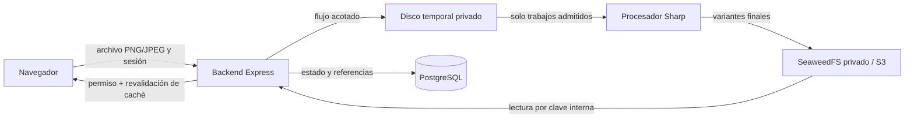

# 7.10 / T02.02 — Componentes y recursos

Fecha inicial: 2026-09-28. Actualizado: 2026-10-12. **T02.02 DONE como diseño/viabilidad local; carga e integración de imágenes pendientes.** SeaweedFS/adaptador S3, Busboy/Sharp y [presupuesto provisional/plan de medición](T02-02-RESOURCES.md) documentados. Parte del [inventario T02.01](T02-01-INVENTORY.md) y de las decisiones de [MEDIA-PLAN](../MEDIA-PLAN.md). Este documento distingue diseño de capacidad todavía no comprobada.

## Recorrido propuesto

Actualización 2026-10-18: el recorrido de catálogo ya está integrado. El hijo Sharp usa `sharp.cache(false)` y un hilo libvips; el Compose de SeaweedFS aplica el objetivo flexible Go `GOMEMLIMIT=384MiB`, conservando su volumen. Véanse [carga integrada y resultados](MEDIA-LOAD-TESTING.md) para distinguir el diseño histórico siguiente de las medidas actuales. UI/otros destinos y dimensionamiento en servidor siguen pendientes.

El backend conserva la autoridad de permisos y la referencia al archivo; SeaweedFS guarda los bytes. El navegador no recibe claves S3 ni acceso directo al bucket. La [cola persistente y estados de trabajo](T02-03-JOBS.md) tienen diseño parcial en T02.03, con ejecución/recuperación pendientes. La sustitución no borra la imagen vigente hasta que las nuevas variantes estén listas y asociadas; la limpieza posterior debe comprobar referencias.

## Componentes candidatos

| Papel | Selección para el prototipo | Por qué encaja | Por comprobar antes de fijarlo |
| --- | --- | --- | --- |
| Objetos | **SeaweedFS 4.47 `weed mini`**, un contenedor, `/data` persistente, bucket privado y solo puerto S3 en loopback | Ofrece el punto S3 acordado en un nodo de pruebas. El modo sin credenciales permite acceso anónimo: exigir credenciales desde el primer arranque. | Imagen/digests y licencia declarada comprobados; adaptador, Put/Get/Head/Delete y persistencia tras recreación probados. Falta consumo bajo carga; véase [LOCAL-SETUP](LOCAL-SETUP.md). |
| Cliente de objetos | **`@aws-sdk/client-s3@3.1141.0`** instalado/fijado en backend; endpoint, región, bucket, credenciales y path-style configurables | `ObjectStore` encapsula las cuatro operaciones; la lectura es un flujo. Facilita probar el mismo contrato frente a R2 en el futuro. | Put/Get/Head/Delete, rechazo 403 y lectura con SDK tras recreación de SeaweedFS 4.47 comprobados en la [prueba local](LOCAL-SETUP.md). Repetir frente a R2 cuando se migre. No prometer compatibilidad completa de todas las funciones S3. |
| Recepción | **`busboy@1.6.0`** y **`@types/busboy@1.5.5`** instalados/fijados, recepción por flujo hacia temporal con nombre interno | El [ensayo aislado](T02-02-BUSBOY.md) verificó bytes, frontera de 10 MB, entradas incompletas/interrumpidas, campos/archivos extra, aislamiento de dos recepciones y limpieza | Build y 8 pruebas PASS; licencia empaquetada MIT comprobada. API, sesión/permisos, admisión global, HTTP real/timeouts y capacidad pendientes de diseño/integración. No equivale a imagen validada ni a T05.01 terminado. |
| Transformación | **`sharp@0.35.5`** instalado/fijado, con tipos incluidos; libvips 8.18.7 en Windows x64 | [Ensayo 11/11 PASS](T02-02-SHARP.md): orientación, color P3→sRGB, metadatos, transparencia, dimensiones/variantes, fuentes pequeñas y reglas de rechazo | Build PASS. APNG exige guardia `acTL` además de pages. Procesador integrado, corpus real/revisión visual y consumo con dos entradas máximas pendientes. Licencias de paquetes inspeccionadas; inventario completo nativo al preparar despliegue |
| Trabajos | **PostgreSQL existente**, elegido para registro/cola persistente de media | [Diseño parcial](T02-03-JOBS.md): relaciona propietario/recurso y conserva estado para consulta; el código ejecutará Sharp | T02.03 completa ejecución, admisión/orden, topes globales, tiempos, cancelación y recuperación. Pruebas reales en T05; no asumir que persistir estado demuestra ejecución o que un contador local representa varias instancias |

Fuentes primarias: [SeaweedFS `weed mini`](https://github.com/seaweedfs/seaweedfs/wiki/Quick-Start-with-weed-mini), [releases de SeaweedFS](https://github.com/seaweedfs/seaweedfs/releases), [ejemplos oficiales del SDK S3 v3](https://docs.aws.amazon.com/sdk-for-javascript/v3/developer-guide/javascript_s3_code_examples.html), [compatibilidad S3 de R2](https://developers.cloudflare.com/r2/api/s3/api/), [busboy y sus límites](https://github.com/mscdex/busboy), [instalación de Sharp](https://sharp.pixelplumbing.com/install/), [opciones de entrada de Sharp](https://sharp.pixelplumbing.com/api-constructor/), [salida de Sharp](https://sharp.pixelplumbing.com/api-output/). Licencias del código fuente: [SeaweedFS 4.47](https://github.com/seaweedfs/seaweedfs/blob/4.47/LICENSE), [SDK](https://github.com/aws/aws-sdk-js-v3/blob/main/LICENSE), [busboy](https://github.com/mscdex/busboy/blob/master/LICENSE), [Sharp](https://github.com/lovell/sharp/blob/main/LICENSE). La imagen descargada declara Apache-2.0; el inventario de dependencias empaquetadas y el de los paquetes backend queda por revisar antes de desplegar.

## Límites, espacio temporal y memoria

Presupuesto inicial del piloto en [T02-02-RESOURCES](T02-02-RESOURCES.md): 1 GiB de área temporal, 1 GiB libre fuera de la proyección de trabajo y 1,5 GiB adicionales para media (1 GiB procesamiento conjunto, 256 MiB SeaweedFS, 256 MiB margen). Son provisiones de planificación, todavía no límites aplicados ni consumos medidos. La contabilidad/admisión y la medición integrada permanecen pendientes.

- **Entrada acordada:** PNG/JPEG estático, archivo de hasta **10.000.000 bytes** y hasta **24.000.000 píxeles**. La extensión y el MIME declarado no bastan: validar contenido real, dimensiones y ausencia de animación antes de procesar. Busboy limita bytes y número de partes; el proxy y Express deben dejar pasar esa petición multipart acotada sin usar `express.json()` para leerla.
- **Disco temporal:** los 12 trabajos admitidos, si todos conservasen su entrada máxima, ocuparían **hasta 120 MB decimales** solo en originales temporales. Es una cota de ese componente, **no** del disco total: añadir transferencias en curso, variantes aún no publicadas, ficheros auxiliares, metadatos y margen operativo. Primero reservar capacidad y limitar la admisión/transferencia; no aceptar archivos indefinidamente cuando la cola esté llena. El temporal no pertenece al volumen permanente `/data` ni a futuros backups de objetos.
- **RAM de imágenes:** una entrada de 24 MP expandida a RGBA representa **96 MB decimales** por fotograma; dos entradas simultáneas son **192 MB decimales** como referencia aritmética. No es una estimación máxima de proceso: Sharp/libvips, buffers, orientación, codificación y el propio backend añaden consumo. Fijar RAM solo tras medir pico RSS y uso nativo con dos casos máximos (JPEG y PNG difíciles) y el backend en marcha.
- **Objetos definitivos:** una principal procesada y variantes pactadas por tipo; nunca el original. No se promete un peso máximo de salida, sobre todo para PNG. Registrar bytes reales de cada variante en las pruebas y contrastarlos con [MEDIA-CAPACITY](../MEDIA-CAPACITY.md).
- **Admisión:** máximo global acordado de 2 trabajos activos + 10 en espera. El cierre de T02.03 debe coordinar esta cifra con la transferencia multipart, los 180 s de espera y los 30 s de procesamiento. Si se excede el presupuesto medido, reducir/adaptar parámetros antes de habilitar el límite de entrada, sin presentar una cifra nueva como decisión aprobada.

## Qué cerrar antes de arrancar y qué comprobar después

1. **T02.02, diseño del piloto — DONE local:** versiones/procedencia, licencias de paquetes, configuración privada/persistencia, ensayos SDK/Busboy/Sharp y [presupuesto provisional/plan operativo](T02-02-RESOURCES.md) registrados. El arranque solicitado por el usuario se adelantó al cierre de T02/T03; los ensayos no presentan estimaciones como resultados de carga ni acreditan producción.
2. **T04, con el servicio ya arrancado:** verificar bucket y credenciales privados, S3 Put/Get/Head/Delete, acceso anónimo denegado, consumo real de SeaweedFS y supervivencia de objetos/metadatos tras recrear el contenedor conservando `/data`.
3. **T05.02/T05.03, con el procesador implementado:** medir disco temporal pico, CPU, RSS y tiempo con dos archivos válidos de 10 MB/24 MP, además de un PNG transparente, JPEG con orientación y casos inválidos. Ajustar límites operativos antes de habilitar uso real.
4. **Migración futura:** probar el mismo adaptador frente a un endpoint R2 de prueba cuando se aborde ese cambio; no crear cuenta ni mover datos ahora.

**Estado:** T02.02 **DONE como diseño/viabilidad local**: servicio/SDK y recepción/procesamiento ensayados, versiones/licencias de paquetes y provisiones/medición registradas. La lectura de 69,25 MiB en reposo es una muestra, no un límite; carga real corresponde a T04/T05/T08. T02.03 [cola persistente/estados](T02-03-JOBS.md) EN CURSO y T02.04 pendiente. Esperar comprensión de la cola antes de ejecución/cancelación. Las notas históricas de ensayos conservan el estado pendiente de recursos que existía al ejecutarlos.
